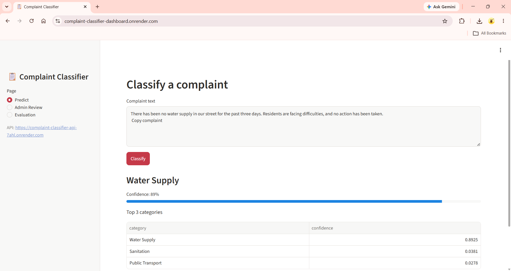
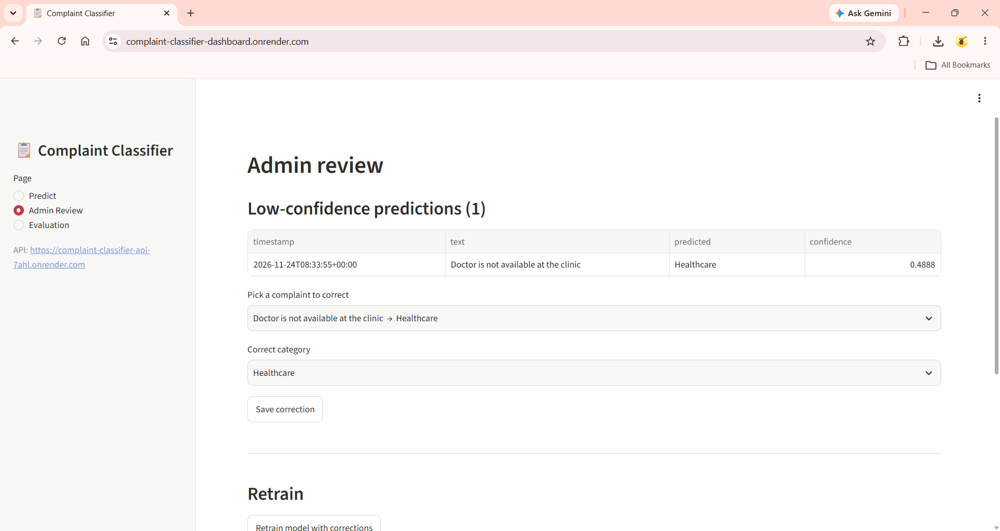
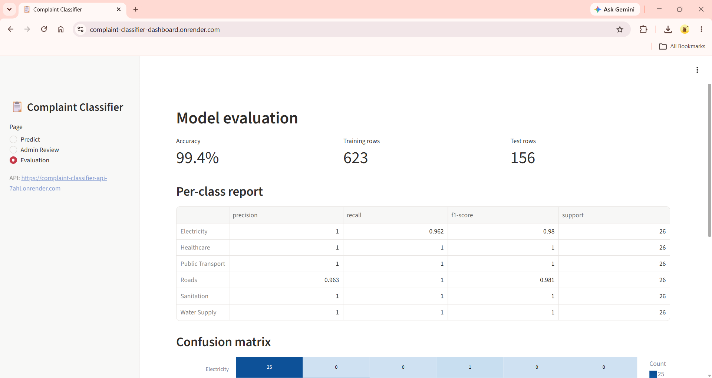
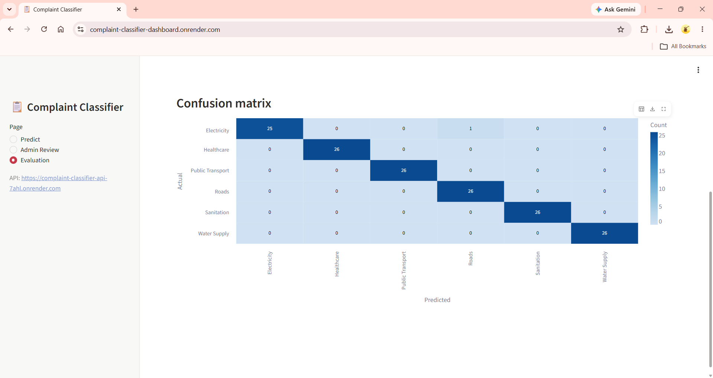

# 📋 Complaint Category Classifier

> 🧠 An NLP-powered service that reads a citizen complaint, predicts its category with a confidence score, and lets an admin review, correct and retrain the model from a dashboard.


## 🔗 Live Project Links

| Resource | Link |
|---|---|
| 🖥️ Live Dashboard | [Open Dashboard](https://complaint-classifier-dashboard.onrender.com) |
| ⚙️ API Documentation | [Swagger API Docs](https://complaint-classifier-api-7ahl.onrender.com/docs) |
| 💻 GitHub Repository | [View Repository](https://github.com/gopikasoundhar/complaint-classifier) |

> **Note:** Both services run on Render's free tier and may sleep when idle. The first request after a break can take some time to load.

---

## 📌 1. Project Overview

Managing a large number of citizen complaints manually can be time-consuming and inconsistent. This project automates the initial complaint classification process using Natural Language Processing (NLP) and Machine Learning.

The Complaint Category Classifier accepts complaint descriptions through a Streamlit dashboard, processes the text, and predicts the appropriate category using a Logistic Regression model.

The system classifies complaints into six categories:

- 💧 Water Supply
- 🛣️ Roads
- ⚡ Electricity
- 🧹 Sanitation
- 🚌 Public Transport
- 🏥 Healthcare

The application also provides prediction confidence scores. Complaints with low confidence are flagged for administrative review.

Administrators can correct incorrect predictions, save the corrections, and retrain the model using the updated dataset.

## 🎯 2. Project Objectives

- Automate citizen complaint categorization using NLP and Machine Learning.
- Predict appropriate complaint categories from user-provided text.
- Display confidence scores for every prediction.
- Identify uncertain predictions for human review.
- Allow administrators to correct classification results.
- Support model retraining using corrected complaint data.
- Display model evaluation metrics through an interactive dashboard.
- Deploy the application for online accessibility.

## 🗺️ 3. System Architecture

The application follows a simple architecture:

1. User enters a complaint through the Streamlit dashboard.
2. Dashboard sends the complaint to the FastAPI backend.
3. Backend preprocesses the input text.
4. TF-IDF converts the text into numerical features.
5. Logistic Regression predicts the complaint category.
6. Prediction and confidence score are returned to the dashboard.
7. Low-confidence predictions are flagged for administrative review.
8. Administrators can correct predictions and retrain the model.


## ✨ 4. Key Features

### 🔤 4.1 Complaint Prediction

- Accepts free-text complaint descriptions.
- Classifies complaints into six predefined categories.
- Displays predicted category and confidence score.
- Shows the top three predicted categories.
- Identifies predictions that require administrative review.

### 🛡️ 4.2 Input Validation

- Rejects empty and whitespace-only inputs.
- Rejects symbols-only complaint descriptions.
- Applies maximum text-length validation.
- Handles invalid and unsupported text inputs safely.

### 🧑‍💼 4.3 Admin Review and Retraining

- Displays complaints requiring administrative review.
- Allows administrators to correct predicted categories.
- Stores corrections in `data/corrections.csv`.
- Supports model retraining using corrected data.
- Displays before-and-after model accuracy.

### 📊 4.4 Model Evaluation Dashboard

- Displays model accuracy.
- Shows training and testing dataset information.
- Provides precision, recall, and F1-score.
- Displays confusion matrix visualizations.
- Helps administrators understand model performance.

### 📤 4.5 CSV Export

- Exports prediction records.
- Exports corrected complaint records.
- Supports downloading stored data for analysis.

### 🔐 4.6 API-Key Protection

- Supports API-key authentication for administrative endpoints.
- Uses the `X-API-Key` header when `ADMIN_API_KEY` is configured.
- Keeps sensitive configuration in environment variables.

### ☁️ 4.7 Cloud Deployment

- FastAPI backend deployed on Render.
- Streamlit dashboard deployed on Render.
- Provides online access to the application.

## 🛠️ 5. Technology Stack

| Component | Technologies |
|---|---|
| Programming Language | Python |
| Machine Learning | Scikit-learn |
| NLP | TF-IDF Vectorization |
| Algorithm | Logistic Regression |
| Backend | FastAPI |
| Frontend | Streamlit |
| Data Processing | Pandas, NumPy |
| Model Storage | Joblib |
| Data Visualization | Altair |
| API Server | Uvicorn |
| Testing | Pytest, HTTPX |
| Version Control | Git, GitHub |
| Deployment | Render |

## 🧠 6. Machine Learning Approach

The project uses Natural Language Processing and supervised machine learning for complaint classification.

### 6.1 Data Collection

A labeled complaint dataset is maintained in:

`data/complaints.csv`

The dataset contains complaint descriptions and their corresponding categories.

### 6.2 Text Preprocessing

The complaint text is cleaned before model training and prediction.

Preprocessing includes:

- Converting text into lowercase.
- Removing unnecessary punctuation.
- Removing extra whitespace.
- Handling empty and duplicate records.

### 6.3 Feature Extraction

TF-IDF (Term Frequency–Inverse Document Frequency) converts complaint text into numerical features.

The project uses:

`TfidfVectorizer(ngram_range=(1, 2))`

### 6.4 Model Training

The project uses the Logistic Regression algorithm.

Configuration:

- Algorithm: Logistic Regression
- Maximum iterations: 1000
- Regularization parameter (C): 10
- Train-test split: 80:20
- Random state: 42

### 6.5 Prediction and Confidence Score

The trained model uses `predict_proba()` to calculate prediction probabilities.

The system identifies the highest-probability category and displays its confidence score.

Complaints with confidence below 0.6 are flagged for administrative review.

### 6.6 Model Saving

The trained model and evaluation metrics are stored using Joblib and JSON files.

- `model/model.joblib`
- `model/metrics.json`

## 📂 7. Project Structure

```text
complaint-classifier/
│
├── app/
│   ├── config.py
│   ├── preprocess.py
│   ├── train.py
│   └── main.py
│
├── dashboard/
│   ├── streamlit_app.py
│   └── requirements.txt
│
├── data/
│   ├── complaints.csv
│   └── corrections.csv
│
├── docs/
│   ├── architecture.png
│   ├── COMMIT_GUIDE.md
│   └── screenshots/
│       ├── dashboard.png
│       ├── prediction.png
│       └── analytics.png
│
├── model/
│   ├── model.joblib
│   └── metrics.json
│
├── scripts/
│   └── generate_dataset.py
│
├── tests/
│
├── .env.example
├── .gitignore
├── render.yaml
├── requirements.txt
└── README.md
```

*Note: Some files and folders are generated during training or application execution.*

## 📸 8. Application Screenshots

### 8.1 Complaint  Predictions



### 8.2 Admin Review



### 8.3 Evaluation Dasboard






## ⚙️ 9. Installation and Setup

### Step 1: Clone the Repository

```bash
git clone https://github.com/gopikasoundhar/complaint-classifier.git
cd complaint-classifier
```

### Step 2: Create a Virtual Environment

```bash
python -m venv venv
```

### Step 3: Activate the Virtual Environment

For Windows:

```powershell
venv\Scripts\activate
```

### Step 4: Install Dependencies

```bash
pip install -r requirements.txt
```

### Step 5: Train the Machine Learning Model

```bash
python -m app.train
```

### Step 6: Start the FastAPI Backend

```bash
uvicorn app.main:app --reload
```

API URL:

http://127.0.0.1:8000

Swagger documentation:

http://127.0.0.1:8000/docs

### Step 7: Start the Streamlit Dashboard

Open another terminal, activate the virtual environment, and execute:

```bash
streamlit run dashboard/streamlit_app.py
```

Dashboard URL:

http://localhost:8501

## 🔧 10. Configuration

Create a `.env` file using `.env.example` as a reference.

| Environment Variable | Description | Default |
|---|---|---|
| `ADMIN_API_KEY` | Protects administrative endpoints | Empty |
| `CONFIDENCE_THRESHOLD` | Minimum prediction confidence | 0.6 |
| `MAX_TEXT_LENGTH` | Maximum complaint text length | 1000 |
| `API_URL` | Backend API URL | http://localhost:8000 |

**Security:** Never upload your actual `.env` file or API keys to GitHub.

## 🔌 11. API Reference

The FastAPI backend provides the following endpoints.

| Method | Endpoint | Purpose |
|---|---|---|
| GET | `/health` | Check API and model status |
| GET | `/categories` | Retrieve available categories |
| POST | `/predict` | Predict complaint category |
| POST | `/correct` | Save corrected predictions |
| POST | `/retrain` | Retrain the machine learning model |
| GET | `/metrics` | Retrieve model evaluation metrics |
| GET | `/predictions` | Retrieve prediction records |
| GET | `/export/predictions` | Export prediction records |
| GET | `/export/corrections` | Export correction records |

Administrative endpoints require the API key when authentication is configured.

### Sample Prediction Request

```json
{
  "text": "There is no water supply in my area since morning"
}
```

### Sample Prediction Response

```json
{
  "category": "Water Supply",
  "confidence": 0.7424,
  "needs_review": false,
  "top3": [
    {
      "category": "Water Supply",
      "confidence": 0.7424
    },
    {
      "category": "Healthcare",
      "confidence": 0.0634
    },
    {
      "category": "Sanitation",
      "confidence": 0.0633
    }
  ]
}
```

*The response values above are illustrative.*

## 📈 12. Model Performance

The initial model evaluation reported the following results:

| Metric | Value |
|---|---|
| Accuracy | 99.4% |
| Training Samples | 623 |
| Testing Samples | 156 |
| Train-Test Split | 80:20 |

**Important:** These results are based on the starter dataset. Similar complaint phrases may occur in both training and testing data. Therefore, the reported accuracy should not be treated as a guarantee of real-world performance. Evaluation on a larger, independent dataset is recommended.

## 🧪 13. Testing

The project uses Pytest and HTTPX for testing.

Run the following command:

```bash
python -m pytest -v
```

The project includes 17 tests covering:

- Text preprocessing.
- Empty and invalid inputs.
- Symbols-only complaint descriptions.
- Non-English input handling.
- API prediction functionality.
- Input length validation.
- Complaint correction.
- Model retraining.
- Data export functionality.

## ☁️ 14. Deployment

The application is deployed using Render.

| Service | Technology | Deployment |
|---|---|---|
| Backend API | FastAPI | [Open API](https://complaint-classifier-api-7ahl.onrender.com/docs) |
| Frontend Dashboard | Streamlit | [Open Dashboard](https://complaint-classifier-dashboard.onrender.com) |

The deployment configuration is maintained in `render.yaml`.

**Deployment considerations:**

- Both services use the free hosting tier.
- Services may experience cold starts.
- Render free-tier storage may be temporary.
- Download important correction records regularly if persistent storage is not configured.

## 🔐 15. Security Considerations

- API keys are maintained through environment variables.
- Sensitive configuration files are excluded from version control.
- Complaint inputs are validated before processing.
- Administrative endpoints support API-key protection.
- Input length restrictions help prevent excessively large requests.

## ⚠️ 16. Project Limitations

- The classifier supports six predefined complaint categories.
- The model is primarily designed for English-language complaints.
- Complaints involving multiple issues receive a single predicted category.
- Model predictions depend on the quality and diversity of training data.
- Free-tier cloud hosting may introduce loading delays.
- Persistent storage requires additional deployment configuration.

## 🚀 17. Future Enhancements

- Support for Tamil, Hindi, and other regional languages.
- Integration of larger real-world complaint datasets.
- Complaint priority and urgency detection.
- Database integration for permanent record storage.
- Real-time complaint tracking.
- Email or SMS notifications.
- Advanced NLP models such as Transformers.
- Improved model evaluation using independent datasets.

## 👩‍💻 18. Author

**Gopika S**

B.E. Computer Science Engineering with Cyber Security

GitHub: [gopikasoundhar](https://github.com/gopikasoundhar)

---

⭐ If you find this project useful, consider giving the repository a star!
